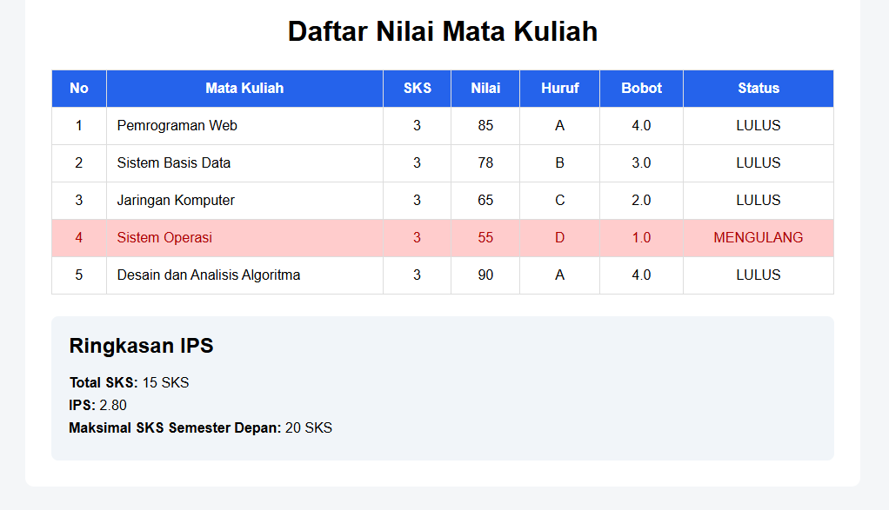

# Latihan PHP 1 - Pengantar PHP & Konsep Backend

## Informasi Tugas

**Mata Kuliah:** Pemrograman Web  
**Materi:** Pengantar PHP & Konsep Backend   
**Jenis:** Latihan Individu  
**Teknologi:** PHP Native, HTML, CSS

---

## Tujuan Pembelajaran

Project ini bertujuan untuk memahami dan menerapkan:

1. Penggunaan variabel dan array pada PHP.
2. Penggunaan array multidimensi.
3. Pembuatan dan penggunaan function.
4. Conditional `if / elseif / else`.
5. Perulangan `foreach`.
6. Pengolahan data PHP.
7. Penggabungan PHP dengan HTML.
8. Perhitungan data menggunakan PHP.
9. Dynamic rendering pada halaman web.
10. Konsep dasar backend menggunakan PHP.

---

## Konsep PHP yang Dipelajari

Project ini menerapkan konsep-konsep berikut:

### Array Multidimensi

Digunakan untuk menyimpan data beberapa mata kuliah beserta atributnya.

```php
$mataKuliah = [
    [
        "nama" => "Pemrograman Web",
        "sks" => 3,
        "nilai" => 85
    ]
];
```

### Function

Digunakan untuk memisahkan proses konversi nilai.

```php
function hitungBobot($nilai)
{
    // proses konversi nilai
}
```

### Conditional

Digunakan untuk menentukan nilai huruf, bobot, dan status kelulusan.

```php
if ($nilai >= 80) {
    // A
}
```

### Foreach

Digunakan untuk melakukan iterasi setiap data mata kuliah.

```php
foreach ($mataKuliah as $mk) {
    // proses data
}
```

### PHP Embedded dalam HTML

PHP digunakan secara langsung di dalam halaman HTML untuk menghasilkan data secara dinamis.

```php
<?= $mk["nama"] ?>
```

---

## Struktur Folder

```text
latihan-php/
│
├── index.php
├── data.php
├── functions.php
├── style.css
└── README.md
```

### `index.php`

Bertanggung jawab untuk:

- Menghubungkan file data dan function
- Melakukan iterasi data menggunakan `foreach`
- Memanggil function `hitungBobot()`
- Menentukan status kelulusan
- Menghitung IPS
- Menentukan batas maksimal SKS
- Menampilkan hasil ke dalam HTML

### `data.php`

Berisi data mata kuliah dalam bentuk **array multidimensi**.

Contoh struktur data:

```php
[
    "nama" => "Pemrograman Web",
    "sks" => 3,
    "nilai" => 85
]
```

### `functions.php`

Berisi function:

```php
hitungBobot($nilai)
```

Function tersebut mengembalikan nilai huruf dan bobot berdasarkan nilai angka.

### `style.css`

Berisi styling untuk tampilan halaman, tabel, ringkasan IPS, serta penanda mata kuliah yang berstatus **MENGULANG**.

### `README.md`

Dokumentasi yang menjelaskan informasi tugas, struktur, teknologi, instalasi.

---

## Cara Menjalankan

### Prasyarat

Pastikan komputer sudah memiliki:

- PHP
- Web browser
- Text editor atau IDE
- XAMPP *(opsional jika menggunakan Apache)*

Untuk memastikan PHP sudah tersedia, jalankan:

```bash
php --version
```

---

### Menggunakan PHP Built-in Server

Buka terminal pada folder project:

```bash
cd php-exercise-1
```

Kemudian jalankan:

```bash
php -S localhost:8000
```

Buka browser dan akses:

```text
http://localhost:8000
```

---

## Contoh Data

Menggunakan contoh lima mata kuliah:

| Mata Kuliah | SKS | Nilai |
|---|---:|---:|
| Pemrograman Web | 3 | 85 |
| Sistem Basis Data | 3 | 78 |
| Jaringan Komputer | 3 | 65 |
| Sistem Operasi | 3 | 55 |
| Desain dan Analisis Algoritma | 3 | 90 |

Dengan data tersebut:

```text
Total SKS = 15
IPS = 2.80
Maksimal SKS berikutnya = 20 SKS
```

Mata kuliah **Sistem Operasi** memperoleh nilai 55 dengan bobot 1.0 sehingga memiliki status **MENGULANG** dan ditampilkan dengan penanda warna merah.

---

## Preview

<p align="center">
  
</p